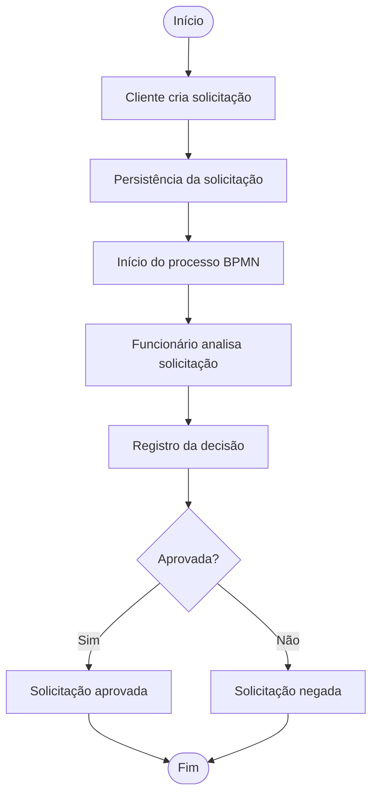

# FlowBank

<p align="center">
  <strong>API backend para gerenciamento de solicitações de aumento de limite de crédito, com fluxo de aprovação orquestrado por BPMN.</strong>
</p>

<p align="center">
  
  
  
  
  
  
  
  
</p>

## Índice

- [Sobre o projeto](#sobre-o-projeto)
- [Destaques técnicos](#destaques-técnicos)
- [Funcionalidades](#funcionalidades)
- [Arquitetura](#arquitetura)
- [Fluxo de aprovação com BPMN](#fluxo-de-aprovação-com-bpmn)
- [Modelo de dados](#modelo-de-dados)
- [Exemplos de uso da API](#exemplos-de-uso-da-api)
- [Decisões arquiteturais e trade-offs](#decisões-arquiteturais-e-trade-offs)
- [Tecnologias](#tecnologias)
- [Executando o projeto](#executando-o-projeto)
- [Infraestrutura e deploy](#infraestrutura-e-deploy)
- [Roadmap](#roadmap)
- [Autor](#autor)

## Sobre o projeto

O **FlowBank** simula um fluxo de trabalho financeiro em que **clientes solicitam aumento de limite de crédito** e **funcionários analisam e decidem** sobre cada solicitação.

Em vez de espalhar regras de aprovação pelo código, o processo é modelado em **BPMN (Flowable)**: as etapas e decisões ficam explícitas e visuais, enquanto os serviços Java executam as regras de negócio.

O projeto foi construído como estudo e portfólio em engenharia backend, cobrindo desde a modelagem do domínio até o deploy em cloud.

### O problema

Em um processo convencional de crédito, várias etapas precisam ser executadas e rastreadas:

1. Recebimento da solicitação do cliente.
2. Consulta e análise das informações (score e risco).
3. Encaminhamento para um funcionário responsável.
4. Aprovação ou rejeição.
5. Registro da decisão e da justificativa.

O FlowBank organiza esse processo com regras de negócio bem definidas e rastreabilidade de cada decisão.

## Destaques técnicos

- **Monólito Modular**: módulos separados por domínio, sem a complexidade de microsserviços.
- **Orquestração com Flowable BPMN**: User Task, Service Task e Exclusive Gateway.
- **Segurança com Spring Security + JWT**: autenticação stateless para funcionários.
- **Auditoria da decisão**: cada aprovação guarda funcionário, score, solicitação, data e justificativa.
- **Deploy real**: containerizado com Docker Compose e publicado em uma instância AWS EC2.

## Funcionalidades

- Autenticação de funcionários (Spring Security e JWT).
- Gerenciamento de clientes.
- Criação de solicitações de aumento de limite.
- Análise de crédito com score e classificação de risco.
- Encaminhamento da solicitação para aprovação.
- Aprovação ou rejeição por funcionários, com justificativa registrada.
- Orquestração do processo de aprovação com Flowable BPMN.
- Persistência no PostgreSQL.

## Arquitetura

O projeto adota o padrão **Monólito Modular**: a aplicação é dividida em módulos por responsabilidade de negócio, e cada módulo mantém suas próprias entidades, DTOs, repositories, services e controllers.


## Fluxo de aprovação com BPMN



| Elemento BPMN | Papel no processo |
|---|---|
| **Start Event** | Inicia o processo |
| **User Task** | Atividade executada pelo funcionário (análise) |
| **Service Task** | Executa a regra de negócio via componente Java |
| **Exclusive Gateway** | Direciona o fluxo conforme o resultado da aprovação |
| **End Event** | Encerra o processo |


## Exemplos de uso da API

> Os exemplos usam `localhost`. Os endpoints protegidos exigem o header `Authorization: Bearer <token>`.

### 1. Dados de uma aprovação


```

```json
{
  "id": 1,
  "status": "APROVADO",
  "dataAprovacao": "2026-11-17T08:58:28.8818058",
  "justificativa": "Solicitação aprovada após análise do histórico financeiro e do perfil do cliente.",
  "funcionario": {
    "id": 1,
    "nome": "Administrador",
    "tipo": "GERENTE",
    "email": "gerente@exemplo.com"
  },
  "solicitacao": {
    "id": 1,
    "limiteSolicitado": 5000.00,
    "motivo": "Gostaria de solicitar um aumento do meu limite para realizar compras e pagamentos de maior valor."
  },
  "score": {
    "id": 1,
    "scoreFinal": 80,
    "risco": "ALTO"
  }
}
```

### 2. Registrar a decisão de uma solicitação

```http
POST http://localhost:8081/api/solicitacoes/4/decisao
Authorization: Bearer <token>
```

**Resposta:** `204 No Content`, indicando que a decisão foi registrada com sucesso, sem corpo na resposta.

### 3. Persistência no PostgreSQL

Após a decisão, o registro fica na tabela `aprovacao`:

```sql
SELECT * FROM aprovacao;
```

```json
{
  "id": 2,
  "data_aprovacao": "2026-11-17T11:25:58.760141",
  "justificativa": "Cliente possui bom histórico financeiro...",
  "status": "APROVADO",
  "funcionario_id": 1,
  "score_id": 3,
  "solicitacao_id": 4
}
```

O registro mostra o relacionamento entre aprovação, funcionário responsável, score utilizado e solicitação correspondente.

## Decisões arquiteturais e trade-offs

As escolhas consideram o escopo atual, a complexidade operacional e a possibilidade de evolução.

| Decisão | Alternativa descartada | Motivação principal |
|---|---|---|
| Monólito Modular | Monólito tradicional / microsserviços | Organização por domínio sem complexidade distribuída |
| PostgreSQL em container | Amazon RDS | Menor custo e controle da configuração |
| EC2 + Docker Compose | ECS / EKS | Simplicidade operacional e controle da infraestrutura |
| Flowable BPMN | Regras de fluxo no código | Processo de aprovação explícito e visual |

<details>
<summary><strong>1. Monólito Modular vs. monólito tradicional vs. microsserviços</strong></summary>

Um monólito tradicional tende a misturar responsabilidades e aumentar o acoplamento conforme cresce. Microsserviços trazem implantação e escala independentes, mas exigem comunicação entre serviços, consistência distribuída, observabilidade e mais infraestrutura. O Monólito Modular mantém a simplicidade de uma aplicação única, com módulos de responsabilidades claras.

| Vantagens | Desvantagens |
|---|---|
| Menor complexidade de infraestrutura | Implantação conjunta dos módulos |
| Comunicação interna mais simples | Escala da aplicação como um todo |
| Menor custo operacional inicial | Necessidade de controlar dependências entre módulos |
| Separação por domínio | Sem isolamento de processos entre módulos |

</details>

<details>
<summary><strong>2. PostgreSQL em container vs. Amazon RDS</strong></summary>

O projeto roda o PostgreSQL em um container Docker na própria EC2, o que reduz o custo inicial, facilita reproduzir o ambiente com Docker Compose e dá controle direto da configuração.

| PostgreSQL em container na EC2 | Amazon RDS |
|---|---|
| Maior controle da infraestrutura | Serviço gerenciado |
| Menor custo inicial potencial | Custo adicional pelo serviço |
| Administração manual | Backups e manutenção gerenciados |
| Disponibilidade sob responsabilidade própria | Alta disponibilidade e recuperação |

Em produção, com requisitos maiores de disponibilidade e recuperação, o RDS seria a evolução natural.

</details>

<details>
<summary><strong>3. EC2 vs. ECS vs. EKS</strong></summary>

A EC2 entrega uma VM com controle direto do ambiente, suficiente para uma aplicação pequena e para demonstrar o deploy de uma aplicação Java containerizada na nuvem.

| EC2 + Docker Compose | ECS | EKS |
|---|---|---|
| Controle direto da máquina | Orquestração gerenciada de containers | Orquestração baseada em Kubernetes |
| Configuração mais manual | Gerenciamento de serviços e tarefas | Maior flexibilidade e complexidade |
| Simples para aplicação pequena | Adequado para containers em escala | Adequado para ambientes Kubernetes |

ECS facilitaria orquestração e escala numa evolução futura; EKS só se justificaria com requisitos que pedissem o ecossistema Kubernetes.

</details>

## Tecnologias

| Tecnologia | Responsabilidade |
|---|---|
| Java 21 | Linguagem principal |
| Spring Boot | API REST |
| Spring Security + JWT | Autenticação e autorização |
| Spring Data JPA / Hibernate | Persistência e mapeamento objeto-relacional |
| PostgreSQL | Banco de dados relacional |
| Flowable BPMN | Orquestração de processos |
| Docker / Docker Compose | Containerização e execução conjunta |
| AWS EC2 | Hospedagem |

## Executando o projeto

### Pré-requisitos

- Git
- Docker e Docker Compose

### Passo a passo

```bash
# 1. Clone o repositório
git clone https://github.com/HerikKou/Flow-Bank.git
cd Flow-Bank

# 2. Configure as variáveis de ambiente (veja abaixo)
cp .env.example .env

# 3. Suba a aplicação
docker compose up --build -d

# 4. Verifique os containers e os logs
docker compose ps
docker compose logs -f app
```

A API fica disponível em `http://localhost:8081`.

### Variáveis de ambiente

Configure no `.env` (exemplos de nomes, ajuste conforme o seu `docker-compose.yml`):

| Variável | Descrição |
|---|---|
| `DB_USER` / `DB_PASSWORD` | Credenciais do PostgreSQL |
| `ADMIN_EMAIL` / `ADMIN_PASSWORD` | Dados do gerente inicial |
| `JWT_SECRET` | Segredo usado para assinar os tokens JWT |

> **Importante:** nunca versione senhas, tokens ou outras credenciais. Mantenha o `.env` no `.gitignore`.

## Infraestrutura e deploy

O FlowBank foi implantado em uma instância **Amazon EC2**, com Docker Compose executando a aplicação Java e o PostgreSQL. O Compose centraliza a configuração do ambiente e permite reproduzi-lo com um único comando.

## Roadmap

- [ ] Testes automatizados com JUnit e Mockito
- [ ] Pipeline de CI/CD
- [ ] Observabilidade: métricas e logs centralizados
- [ ] Documentação da API com OpenAPI/Swagger
- [ ] Avaliar Amazon RDS para o banco
- [ ] Avaliar ECS para orquestração dos containers

## Autor

**Herik Kato**

- GitHub: [HerikKou](https://github.com/HerikKou)
- LinkedIn: [Herik Kato](https://linkedin.com/in/herik-kato-dev)

---

<p align="center">
  Desenvolvido como projeto de estudo e portfólio em engenharia backend.
</p>
